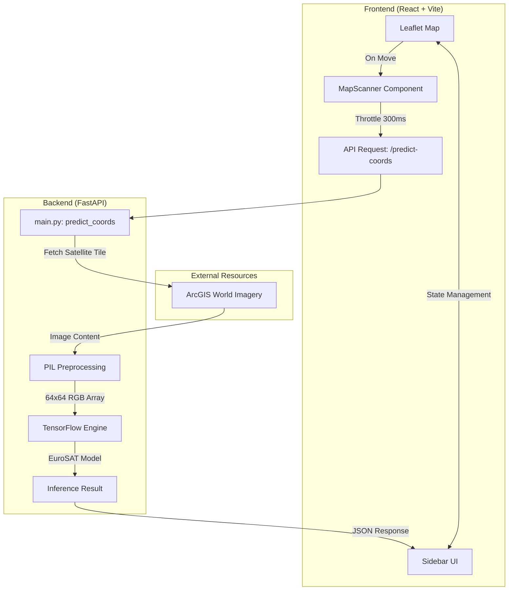
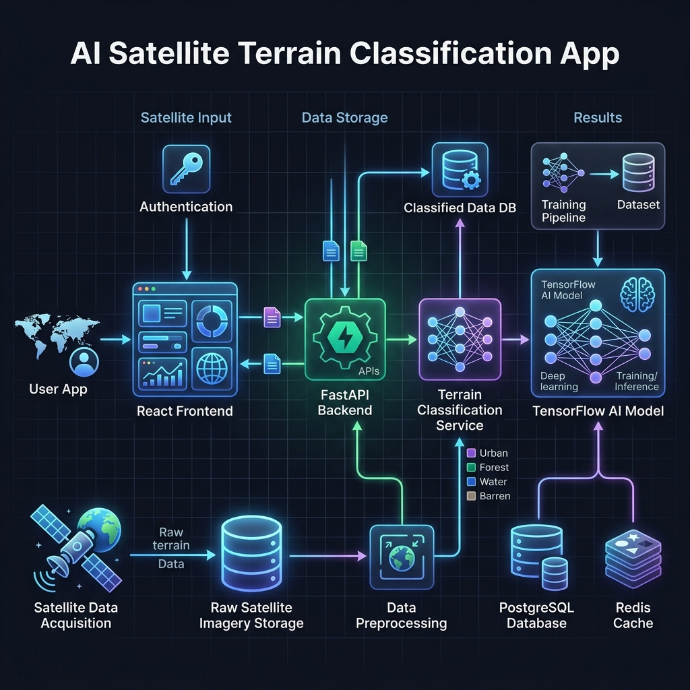
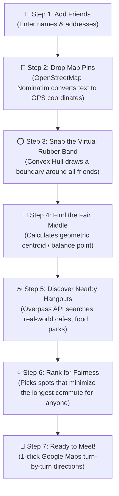

# Terrain AI - Real-time Satellite Imagery Classifier


## 🌍 About Terrain-AI

**Terrain-AI** is an intelligent, dual-mode geospatial platform that combines satellite deep learning and interactive map utilities into an intuitive web experience:
1. **AI Terrain Classifier**: Automatically scans satellite imagery anywhere in the world and classifies land types (forests, cities, rivers, farmland, industrial zones, etc.) in real time.
2. **Connect (Fair Group Meetups)**: Takes the friction and arguments out of planning group hangouts by finding the fair, halfway midpoint for friends scattered across a city and recommending real cafes, restaurants, and parks.

---

### ✨ Key Highlights

* 🤖 **Instant AI Terrain Classification**: Scans live satellite imagery and predicts land use across 10 categories with real-time confidence scores.
* 🤝 **Connect – Fair Midpoint Finder**: Eliminates commute arguments by finding the exact geographic balance point for any group of friends or coworkers.
* ⭕ **"Rubber Band" Boundary (Convex Hull)**: Dynamically calculates and displays the shared territory covering all group members.
* ☕ **Smart Venue Recommendations**: Queries live OpenStreetMap data to discover real cafes, restaurants, parks, malls, and attractions in the fair halfway zone.
* 🚗 **1-Click Turn-by-Turn Navigation**: Directly opens Google Maps directions pre-configured for each individual group member from their starting point.
* 🗺️ **Dual-Layer Mapping**: Automatically switches between high-res Esri satellite imagery (for AI analysis) and clean OpenStreetMap vector tiles (for meetup planning).
* ⚡ **Sleek Glassmorphic Interface**: Fully responsive, high-performance UI built with React 19, Framer Motion, and Tailwind CSS.

---

### 🎯 Project Goal

The goal of Terrain-AI is to make geospatial intelligence and everyday map planning effortless and accessible. Whether analyzing planetary land cover using computer vision or simply coordinating where friends should meet without anyone making an unfair commute, Terrain-AI combines modern AI, geometric algorithms, and interactive maps into a clean, user-friendly tool.

---

## 📘 Table of Contents
- [Features](#-features)
- [System Architecture (Terrain Classifier)](#-system-architecture)
- [Connect – Fair Group Meeting Spot Finder](#-connect--fair-group-meeting-spot-finder)
- [Connect Architecture (In Plain English)](#-connect-architecture-in-plain-english)
- [Workflow](#-workflow)
- [Tech Stack](#-tech-stack)
- [Installation](#-installation--usage)
- [Future Enhancements](#-future-enhancements)
- [Deployment link](#-Deployment-link)
- [Author](#-author)

---

## 🚀 Features

### 🌍 1. Terrain AI Scanner
- **Real-Time Crosshair Scanner**: A pulsing scanner automatically analyzes the terrain under the center of your screen as you pan and zoom across the globe.
- **10 Land-Use Categories**: Identifies Forest, Residential neighborhoods, Highway networks, Industrial zones, Agricultural fields, Pastures, Permanent crops, Wild vegetation, Rivers, and Lakes.
- **Precision Confidence Meters**: Real-time percentage breakdowns indicating the model's certainty for each category.
- **Scan History Tracker**: Keeps a running log of past scans during your session for quick reference.
- **Current Location Jump**: One-tap geolocation button to instantly fly the map to your current coordinates.

### 🤝 2. Connect – Fair Group Meeting Spot Finder
- **No More Commute Arguments**: Add friends and their starting addresses; Connect automatically determines an equitable middle ground so no one gets stuck with an unfair, marathon commute.
- **Interactive Map Pins**: Drop and manage pins for multiple group members using free-text address lookup (geocoding).
- **Virtual "Rubber Band" Perimeter**: Stretches a smooth outer boundary (*Convex Hull*) around all friends to visualize your group's shared area.
- **Curated Midpoint Venues**: Automatically searches and lists open, popular spots located in the middle zone:
  - ☕ **Cafes & Coffee Shops**
  - 🍽️ **Restaurants & Eateries**
  - 🌳 **Parks & Outdoor Spaces**
  - 🎬 **Theatres & Cinemas**
  - 📸 **Tourist Attractions & Landmarks**
  - 🛍️ **Shopping Centers & Malls**
- **Fairness Scoring & Distance Breakdown**: View exact distances from every single friend to each suggested spot (e.g., *"Alex: 3.2 km, Sam: 3.5 km"*).
- **1-Click Google Maps Directions**: Tap any member under a venue to immediately launch Google Maps with turn-by-turn driving or transit directions.
- **Dual Mode Switcher**: Easily toggle between the AI Terrain Scanner and the Connect Meeting Planner with a single click.

---

## 🏗️ System Architecture
> The system integrates a Leaflet-based frontend with a FastAPI backend. The backend fetches satellite tiles from ArcGIS/ESRI servers and processes them through a pre-trained EuroSAT model for sub-100ms inference.



---

## 🤝 Connect – Fair Group Meeting Spot Finder

### 💡 The Problem It Solves
We’ve all experienced the frustration of trying to plan a meetup with friends or colleagues living across different parts of a city:
> *"Let's meet near my place!"*  
> *"No way, that takes me an hour and you only 10 minutes!"*

Deciding on a spot that is **fair to everyone** usually turns into endless texting, arguing, and checking map apps.

### ✨ What Connect Does (In Layman's Terms)
**Connect** takes the headache and unfairness out of group meetups:
1. **Add Everyone**: Type in each friend's name and starting point (address, landmark, or neighborhood).
2. **Find the Fair Center**: The app maps everyone out, draws a boundary around the whole group, and calculates the exact geometric midpoint where overall travel is balanced.
3. **Discover Fun Places**: It automatically suggests popular spots—like **cafes, restaurants, parks, shopping malls, and theaters**—located in that fair halfway zone.
4. **Compare Travel Distances**: Shows exactly how far each friend has to travel to every suggested venue so no one gets an unfair commute.
5. **Hit the Road**: Tap on any venue to launch **Google Maps** with one click for turn-by-turn directions.

---

## 📐 Connect Architecture (In Plain English)

Here is how the Connect feature works behind the scenes, explained in simple, everyday terms:



### 🔍 How Each Piece Works:

1. **📍 From Address to Pin (Geocoding)**
   - When you type an address (e.g., *"Indiranagar, Bangalore"* or *"Central Park, NY"*), the app uses a free, open-source map directory called **OpenStreetMap Nominatim**.
   - Nominatim instantly converts the address text into exact GPS coordinates (latitude and longitude) and places a pin on the map.

2. **⭕ The "Rubber Band" Boundary (Convex Hull)**
   - Imagine sticking a pin on a corkboard for every friend in your group, then wrapping an elastic rubber band around all of them. The rubber band snaps tight to form a clean perimeter enclosing everyone.
   - In computer science, this shape is called a **Convex Hull** (calculated using the *Graham Scan* algorithm). It outlines your group's shared territory so the app knows the exact area to search within.

3. **🎯 Finding the True Fair Middle (Centroid)**
   - The app computes the geometric balance point (center of mass) of all the pins. This is the theoretical spot where everyone travels roughly the same distance.

4. **☕ Finding Real Hangout Venues (Overpass API)**
   - Instead of pointing you to an empty intersection, the app queries **OpenStreetMap's live venue engine (Overpass API)** to find real, open places in that middle area.
   - You can filter venues by category:
     - ☕ **Cafes**
     - 🍽️ **Restaurants**
     - 🌳 **Parks & Green Spaces**
     - 🎬 **Theatres & Cinemas**
     - 📸 **Famous Landmarks & Tourist Spots**
     - 🛍️ **Shopping Malls**

5. **⭐ Ranking Spots for Maximum Fairness**
   - The app calculates the travel distance from **every single person** to each potential venue.
   - It ranks places that avoid leaving any one person with an excessively long commute. The venues with the most balanced travel times for everyone appear at the top.

6. **🚗 1-Click Directions**
   - When you select a venue, the app displays a clear breakdown of each member's distance (e.g., *"Alex: 3.2 km, Sam: 3.6 km"*).
   - Clicking on a person's card instantly opens **Google Maps** with turn-by-turn navigation already set up from their starting point to the venue.

---

## 🔄 Workflow
1. **Explore**: Pan or search the interactive map to any location worldwide.
2. **Scan**: The pulsing scanner fetches 64x64 resolution satellite tiles for the center point.
3. **Analyze**: The FastAPI backend processes the tile through the TensorFlow engine.
4. **Visualize**: Results are displayed with confidence bars and categorical history.

---

## 🛠️ Tech Stack
| Layer | Technology |
|--------|-------------|
| **Frontend** | React 19 + Vite + Tailwind CSS |
| **Animations & Icons** | Framer Motion + Lucide React |
| **Interactive Maps** | Leaflet + React-Leaflet |
| **Map Imagery** | Esri ArcGIS (Satellite Tiles) + OpenStreetMap (Street Maps) |
| **Geospatial & POI APIs** | OSM Nominatim (Geocoding) + Overpass API (Places of Interest) |
| **Algorithms** | Graham Scan (Convex Hull) + Centroid & Fair Distance Optimization |
| **Backend** | Python 3.11 (FastAPI + Uvicorn) |
| **AI/ML** | TensorFlow + EuroSAT CNN Model |
| **Deployment**| Hugging Face Spaces (Docker) & Azure|

---

## 💻 Installation & Usage

### Local Development
```bash
git clone https://github.com/AryanEjantkar/Terrain-AI-.git
cd terrain-predictor

# Backend Setup
cd backend
pip install -r requirements.txt
python main.py

# Frontend Setup
cd ../frontend
npm install
npm run dev
```

---

## 🔮 Future Enhancements
- **TF.js Migration**: Move inference to the browser for zero-latency offline analysis.
- **Change Detection**: Compare historical satellite data to detect deforestation or urban sprawl.
- **Multi-Model Support**: Switch between specialized models for agriculture, forestry, or urban planning.
- **Global Search**: Enhanced location indexing for faster navigation.

---


---
## Deployment link

https://huggingface.co/spaces/AryanYeager/Terrain-AI

https://terrain-ai-web-4702.azurewebsites.net/


---

## 👨‍💻 Author

**Aryan Vimal Ejantkar**
🎓 B.Tech (AIML) – VIT Bhopal
💼 Passionate about AI, ML, and automation

---
